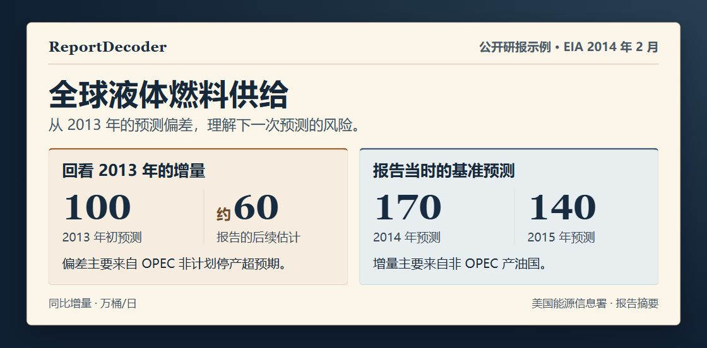

# ReportDecoder

简体中文 · [English](README.en.md)

**读懂研报的证据、推导和结论。**

面向 Codex 和 Claude Code 的研报解码 Skill。把文字版金融与经济研报 PDF 整理成中英文精读笔记，保留原文主体、数据口径和结论条件。

[查看公开示例](#示例丨sample) · [安装与调用](#安装与调用)


[](https://github.com/MakerFlyFly/ReportDecoder/actions/workflows/ci.yml)
[](LICENSE)

## 示例丨sample

美国能源信息署（EIA）在 2013 年初预计，当年全球液体燃料供给将增加 100 万桶/日。2014 年 2 月报告对同一年给出的后续估计约为 60 万桶/日。笔记从这次预测偏差出发，梳理 OPEC 停产如何影响供给，以及 2014—2015 年基准预测面临哪些风险。

[原始 PDF](samples/eia-2014-oil-supply/source.pdf) · [中文解码](samples/eia-2014-oil-supply/decode.zh-CN.md) · [English notes](samples/eia-2014-oil-supply/decode.en.md) · [匿名解读](samples/eia-2014-oil-supply/analysis.zh-CN.md)

报告来源、署名、使用条款和复现步骤见 [示例说明](samples/eia-2014-oil-supply/README.md)。

[](samples/eia-2014-oil-supply/decode.zh-CN.md)

## 两种读法

- **默认解码**保留帮助理解论证的真实公司、机构、报告和数据来源。页码、图表号或原文链接按需要保留。
- **匿名解读**在用户明确要求时启用。主体换为稳定称谓，隐藏可识别的出处，同时保留研究判断及相关数据。

两种读法都先归类，再通读正文和图表。论证段落说明研究重点、必要假设、证据与结论。行情和观察数据采用简短段落或表格，保留时间、单位和口径。

每次可读一份中英文**文字版 PDF**。笔记和导读跟随请求正文的语言，也可明确指定简体中文或英文。只提供附件、路径或命令时默认用简体中文。报告内的图片图表可渲染阅读，纯扫描件需要先取得可用的文字层。宿主模型负责解读，Python 和 Poppler 负责本地读取文件。

## 安装与调用

双语输出从 `v0.3.0` 起可用。下载 Release 的 ZIP 并解压，或使用当前工作区，把完整的 `research-report-reader` 目录复制到工具的 skill 目录。 [下载最新版](https://github.com/MakerFlyFly/ReportDecoder/releases/latest)

- **Codex** 使用项目的 `.agents/skills/` 或个人的 `~/.agents/skills/`。
- **Claude Code** 使用项目的 `.claude/skills/` 或个人的 `~/.claude/skills/`。

运行依赖为 **Python 3.9+** 和 Poppler 原生程序 `pdfinfo`、`pdftotext`、`pdftoppm`。从项目根目录可检查依赖。

```bash
python research-report-reader/scripts/pdf_tools.py doctor
```

安装后重新加载 skill，在对话中附上 PDF，或提供工作区文件路径。默认请求可写成下面这样。

```text
使用 research-report-reader 解码这份研报，讲清证据如何导向结论。
```

需要匿名时，在请求中明确指定。

```text
使用 research-report-reader 匿名解读这份研报。
```

也可以直接指定语言，例如 `请用 research-report-reader 英文解码这份 PDF。`

从 `v0.2.0` 升级后，英文请求默认生成英文笔记。用英文提问并希望保留中文输出时，可明确指定“用简体中文解码”。笔记默认保存在工作区的 `outputs`，聊天里会给出导读与文件链接。 [完整使用说明](research-report-reader/USAGE.md)

## 开发与验证

在仓库根目录运行下列命令。

```bash
python -m pip install -r requirements-dev.txt
python scripts/validate_project.py
python -m unittest discover -s research-report-reader/tests -v
python scripts/package_skill.py --output-dir tmp/skill-build
```

CI 在 Ubuntu 22.04 的 Python 3.9 和 3.12 环境校验链接、样例 PDF、笔记创建与安装包。上面的命令把本地校验包保存到 `tmp/skill-build`。 [验收说明](research-report-reader/VALIDATION.md) · [贡献说明](CONTRIBUTING.md)

## 许可证

项目的原创代码、文档、模板和解读采用 MIT。示例原文沿用发布方的权利与署名要求。 [MIT 许可证](LICENSE) · [第三方材料说明](THIRD_PARTY_NOTICES.md)
